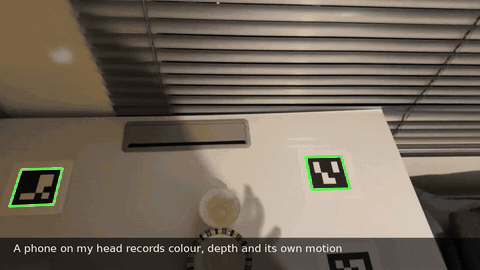
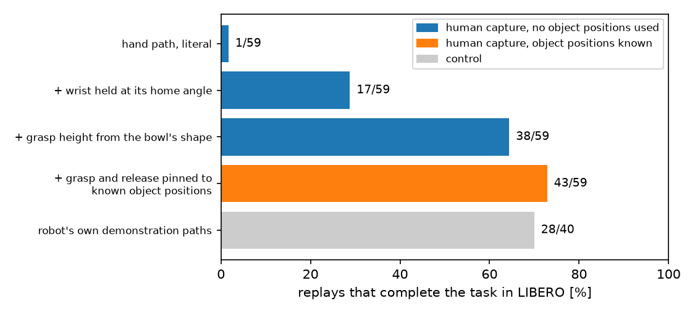
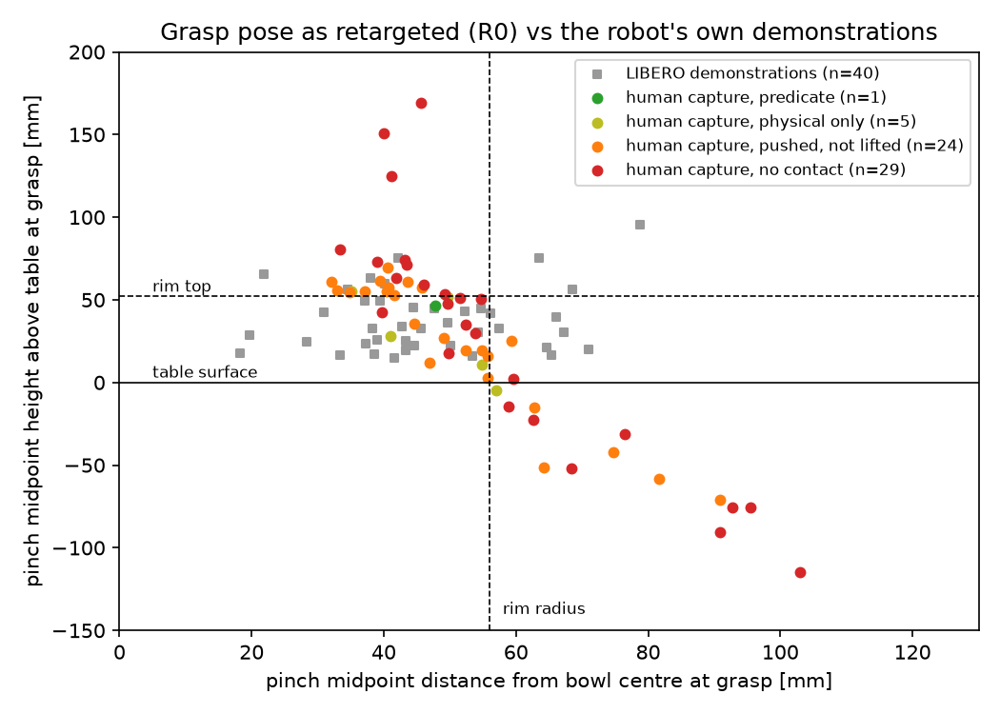
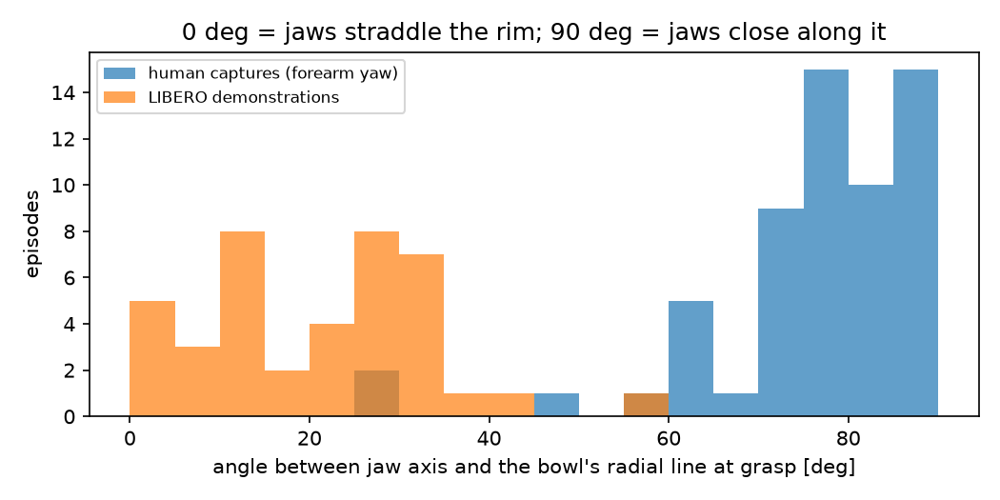
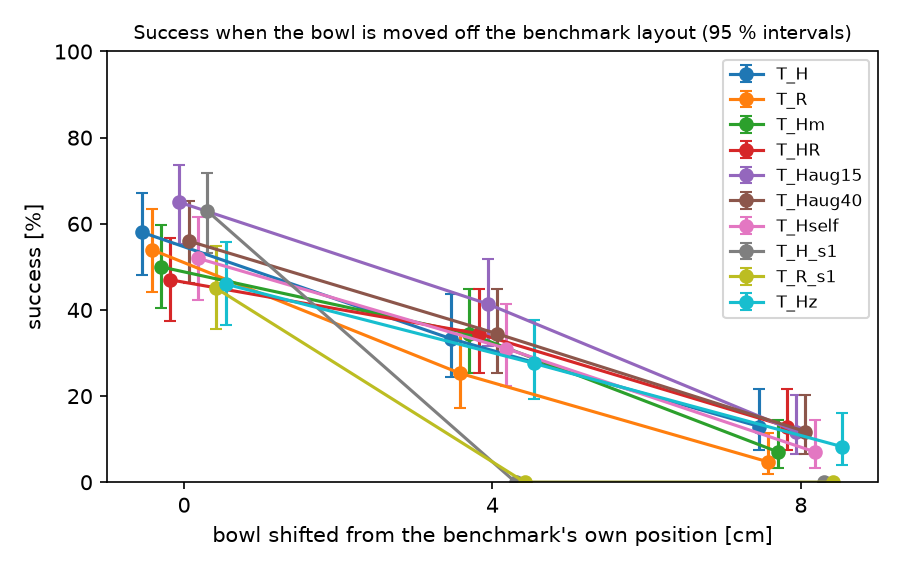

# hand-to-panda

Submission for Humanoid's "Internship, Robot Learning Research" challenge.

Through egocentric captures, using my phone, of my hand moving a bowl and placing it on a plate,
we were able to drive a simulated Franka Panda arm to complete the task in a simulated LIBERO
environment. Using 2 simple constants taken from the robot's own demonstrations, we successfully
completed the task in the simulated environment in 38 out of the 59 captures done. Using these
38 captures, we trained a SmolVLA policy and evaluated it on the corresponding LIBERO benchmark.

**[▶ Quick initial presentation video of the entire project here!](https://youtu.be/u_Guec2Ekrg)**

[](https://youtu.be/u_Guec2Ekrg)



One capture from start to finish ([better quality here](docs/examples/teaser.mp4)).

## This repo's layout

```
config.yaml                      important constants
env.sh                           what I source before each session (caches, GPU pin, MUJOCO_GL)
docs/results.md                  every number, in one place
docs/figures/                    the figures and the animation above
docs/intermediate_format.md      the interoperation defined between the humanoid-vision and the humanoid-sim parts of the project
docs/recording_protocol.md       the step-by-step capture procedure I followed in order to make the small dataset
docs/recording/                  table plan, physical setup, the marker PDF I printed
src/humanoid_challenge/          the short source functions used to create the dataset, the pipeline and the simulation

  markers.py                     ArUco markers, board placement, detection in order to get a valid camera pose
  board_calibration.py           recover the taped layout from a slow pan calibration sweep
  synthetic.py                   synthetic board renderer, used by the tests
  tracking.py                    map the waypoints from the recordings to LIBERO actions
  record3d.py                    iPhone Record3D .r3d files parser
  hands.py                       MediaPipe model to get hand landmarks -> grasp point + pinch
  geometry.py                    unprojection, depth sampling, rigid frame fitting
  trajectory.py                  marker + ARKit -> table-frame camera trajectory
  retarget.py                    hand + depth -> absolute EEF path + binary gripper
  interim.py                     intermediate format, validity rules enforced
  sim_dataset.py                 replay -> LeRobot dataset
tools/                           all the job scripts; all re-runnable
tests/                           geometry tests that need no recorded data
```

## Built on

LIBERO, LeRobot and SmolVLA, MediaPipe Hands, Record3D; the layout-jitter replay follows
MimicGen's object-centric idea.

## How a capture becomes a robot path

1. **Record.** iPhone 16 Pro Max, Record3D: RGB, LiDAR depth and ARKit camera pose. Four ArUco
   markers on the table. 59 pick captures over 5 bowl positions, 11 push captures.
   (`docs/recording_protocol.md`, `docs/recording/setup_sheet.png`)
2. **Table frame.** Marker sightings and ARKit poses are fused into one camera-to-table
   transform per capture (`markers.py`, `trajectory.py`).
3. **Hand.** MediaPipe hand landmarks; thumb and index tips lifted to 3-D through the depth
   map; the gripper target is their midpoint, the gripper command is their distance
   thresholded with hysteresis (`hands.py`, `retarget.py`).
4. **Replay.** The path is tracked on a Panda in LIBERO by a small closed-loop controller;
   the simulator records camera images, robot state and the commands sent
   (`tracking.py`, `sim_dataset.py`, `tools/build_sim_dataset.py`).
5. **Policy.** SmolVLA is trained on the successful replays and evaluated on the benchmark's
   own initial states (`tools/train_arm.sh`, `tools/eval_arm.sh`, `tools/policy_rollout.py`).

The policy never sees the phone video: the captures supply the actions, the simulator the
observations.

## Retargeting result - dataset construction



Direct retargeting of the recorded hand trajectories and actions to the simulator space fails
in almost all sequences: only 1 out of 59 successfully completes the simple "put the bowl on
top of the plate" task.

Upon closer inspection, the failures follow simple patterns. Compared with 40 of the
benchmark's own demonstrations, the retargeted gripper is turned the wrong way and closes too
high, while its position on the table is fine:




If we ignore wrist yaw changes and fix the gripper to be held continuously at its home
orientation, as the robot does in its own demonstrations, 17 out of 59 recordings directly
retargeted successfully complete the task.

If we account for the imperfect height matching between the real bowl used to record and the
simulated one, we can fit the grasp height to match that of the simulated bowl (38 mm, 14 mm
below its rim), making 38 out of 59 recordings succeed. These are the 2 constants; nothing
tells the robot where the bowl or the plate are.

As an upper bound, if we were to directly set the grasp point in the simulation to the known
3D position of the rim of the bowl, 43 out of 59 retargeted recordings end up succeeding.

| replay of the 59 pick captures in LIBERO | object positions used | task completed |
|---|---|---|
| hand path, literal | – | 1/59 |
| + gripper held at its home orientation | none | 17/59 (29 %) |
| + grasp height taken from the bowl's shape (38 mm, 14 mm below the rim) | none | **38/59 (64 %)** |
| + grasp and release pinned to known object positions | bowl, plate | 43/59 (73 %) |
| control: the benchmark's own demonstration paths, same tracker | – | 28/40 (70 %) |

As a final control, we can take the benchmark's own teleoperated demonstration paths and run
them through the same tracker: 28 out of 40 of those succeed.

## Policies and results

Once a successful dataset was created, a SmolVLA (pretrained SmolVLM backbone, action expert
from scratch) is trained.

15 000 steps, batch 64, identical recipe for every arm.

100 evaluation episodes per number: five `libero_spatial` tasks, the benchmark's own 20 initial
states each.

| trained on | episodes | `lerobot-eval`, 360 px | harness, 256 px | second seed |
|---|---|---|---|---|
| human-derived replays (pinned) | 43 | 56 | 58 | 63 |
| robot-derived replays | 28 | 60 | 54 | 45 |
| human-derived, matched per task to the robot set | 28 | 35 | 50 | – |
| both | 71 | 48 | 47 | – |
| human-derived, no object positions (the 38 above) | 38 | – | 46 | – |

95 % intervals are about ±10 points. Details and per-task numbers: `docs/results.md`.
The 38-episode set has only 3 episodes for one task (the session with the poor depth lift),
and the policy scores 0/20 there; on the other four tasks it is 46/80.

Using ONLY our recorded dataset and a SmolVLA, we are able to train a policy on par with the
one resulting from just the robot's own teleoperated data.

## Beyond the benchmark layout



Beyond this training, we wanted to test the generalization capabilities of the trained
policies by moving the bowl away from the training and benchmark spots. By just moving the
bowl 4 cm and 8 cm in every cardinal direction away from the benchmark position, all policies
drop down to about 30 % and about 10 % respectively.

| trained on | benchmark position | bowl moved 4 cm | bowl moved 8 cm |
|---|---|---|---|
| human-derived replays (pinned) | 58 % | 33 % | 13 % |
| robot-derived replays | 54 % | 25 % | 5 % |
| human-derived, matched per task to the robot set | 50 % | 34 % | 7 % |
| both | 47 % | 34 % | 13 % |
| human-derived, no object positions | 46 % | 28 % | 8 % |

We also tried expressing the grasp point relative to the bowl: using the pinned grasp position
and then compensating for that correction lets us bend the training trajectories to fit any
initial bowl position and still finish at the target plate. Each capture was replayed onto 3
jittered bowl positions, which gives us many more episodes.

| bowl jittered by up to | episodes | benchmark position | bowl moved 4 cm | bowl moved 8 cm |
|---|---|---|---|---|
| no jitter (the pinned replays above) | 43 | 58 % | 33 % | 13 % |
| ±15 mm | 118 | **65 %** | 41 % | 12 % |
| ±40 mm | 102 | 56 % | 34 % | 12 % |

The ±15 mm set gives the best policy of the whole project. It has both more variety and about
3 times more episodes, and we did not separate which of the two helped.

### Self-training: letting the policy learn from its own attempts

Finally, a self-training round was attempted: here we attempt to improve the policy without
any new human data. It follows one of the challenge's own suggestions (bootstrap a policy,
then use RL to improve it) in its simplest form: the simulator's success signal decides which
of the policy's own attempts it gets to learn from.

1. **Bootstrap.** Start from the policy trained on our 43 human-derived replays.
2. **Act.** Let it attempt the task on its own in the simulator, on 150 starting layouts that
   are never used for evaluation.
3. **Reward.** The simulator says which attempts completed the task. 77 of the 150 did.
4. **Learn.** Those 77 successful attempts, generated by the policy itself, are added to the
   43 demonstrations, and a new policy is trained on the 120 episodes.

The whole loop runs end to end with `tools/policy_rollout.py --record`. After one round the
new policy scores 52/100, against 58/100 before, so one round did not improve it. Keeping only
the successes mostly shows the policy what it could already do; more rounds, or weighting the
attempts by how well they went, are the natural next step.

## Running the code, reproducing the results

### Setup

What a plain Linux server needs before starting:

- an NVIDIA GPU with a working driver (the simulator renders headless through EGL; training
  one policy takes about 13 GB of GPU memory and 2 hours on an A100),
- `conda` (Miniconda is enough) and `git`,
- about 40 GB of free disk for the two environments, the model weights and the captures.

Everything is installed inside the repository folder; nothing is written elsewhere.

```bash
git clone https://github.com/gaperezsa/hand-to-panda.git
cd hand-to-panda
source env.sh        # do this in every new shell: caches inside the repo, GPU pin, headless rendering
```

There are two conda environments, because the simulator needs `opencv-python-headless` and
the vision side needs `opencv-contrib-python`, and both install a module called `cv2`.

```bash
# 1. humanoid-sim: Python 3.12, ffmpeg, cmake, LeRobot 0.6.2 at the commit used here
#    (brings LIBERO, robosuite 1.4.0, MuJoCo 3.8.1, PyTorch 2.11.0)
bash tools/setup_sim_env.sh
conda activate $SIM_ENV
python tools/setup_libero.py          # writes LIBERO's config and downloads its assets
python tools/check_egl.py             # should print PASS: headless rendering works

# 2. humanoid-vision: MediaPipe 1.0.1 and OpenCV 5.0.0
conda create --prefix $VISION_ENV python=3.12 -y
conda install --prefix $VISION_ENV -c conda-forge libgles -y     # MediaPipe needs libGLESv2 on a headless machine
$VISION_ENV/bin/pip install opencv-contrib-python mediapipe numpy scipy pillow pyyaml pyliblzfse matplotlib reportlab pytest

# the MediaPipe hand model
mkdir -p data/models
curl -L -o data/models/hand_landmarker.task \
  https://storage.googleapis.com/mediapipe-models/hand_landmarker/hand_landmarker/float16/latest/hand_landmarker.task

$VISION_ENV/bin/python -m pytest tests -q     # 41 tests, no captures needed
```

To use a different GPU, set `HUMANOID_GPU` before sourcing `env.sh` (for example
`HUMANOID_GPU=2 source env.sh`).

### Data download

The raw captures (14 GB, 71 `.r3d` files) are not in the repository. They are public here:
[gperezsantamaria/hand-to-panda-captures](https://huggingface.co/datasets/gperezsantamaria/hand-to-panda-captures)

```bash
conda activate $SIM_ENV
hf download gperezsantamaria/hand-to-panda-captures --repo-type dataset --local-dir data
```

That puts the files where the scripts expect them:

```
data/raw/A_t2/A_t2_001.r3d ...     one folder per recording session: A_t2, A_t0, A_t8, A_t1, A_t6, B_push, test
data/interim/A_t2_001.npz ...      the hand path already extracted from each capture
```

### Calibration, extraction, retargeting, training

```bash
# captures (data/raw/<session>/*.r3d) -> table-frame hand paths (data/interim/*.npz)
conda activate $VISION_ENV
python tools/calibrate_board_from_sweep.py data/raw/test/test_001.r3d
python tools/retarget_capture.py 'data/raw/A_*/*.r3d' --glob

# replay the 59 pick captures in LIBERO: the four rows of the retargeting table, and the control
conda activate $SIM_ENV
PICK=A_t2,A_t0,A_t8,A_t1,A_t6
B="python tools/build_sim_dataset.py --source interim --chunks $PICK"
$B --root outputs/datasets/R0   --no-yaw-lock --no-anchor-grasp                          > outputs/build_R0.log
$B --root outputs/datasets/R1np --no-anchor-grasp --no-place-correction                  > outputs/build_R1np_all.log
$B --root outputs/datasets/R5   --anchor-height-only --no-place-correction --only-success > outputs/build_R5_all.log
$B --root outputs/datasets/R3   --only-success                                           > outputs/build_R3.log
python tools/build_sim_dataset.py --source reference --episodes-per-task 8 \
    --root outputs/datasets/Rref                                                         > outputs/build_Rref.log
python tools/plot_results.py          # prints the table and redraws docs/figures/replay_yield.png

# train a policy on the 38 replays that use no object positions (about 2 hours on one GPU)
tools/train_arm.sh T_Hz outputs/datasets/R5 0
```

## Reproducing the experiments

### Benchmark evaluation

```bash
conda activate $SIM_ENV
CKPT=outputs/train/T_Hz/checkpoints/015000/pretrained_model

# LeRobot's own evaluation: 5 tasks x 20 episodes
tools/eval_arm.sh T_Hz $CKPT 0
python tools/summarize_eval.py T_Hz

# the same evaluation through our harness (it starts 3 background workers; wait for them to finish)
tools/run_rollouts.sh 3 G0_T_Hz --ckpt $CKPT --policy T_Hz --init-ids 0-19 \
    --out outputs/rollouts/G0_T_Hz.jsonl
python tools/summarize_rollouts.py outputs/rollouts/G0_*.jsonl
```

### Moving the bowl 4 cm and 8 cm

```bash
tools/run_rollouts.sh 3 E1_T_Hz --ckpt $CKPT --policy T_Hz --init-ids 0-4 \
    --shifts "0.04,0;-0.04,0;0,0.04;0,-0.04;0.08,0;-0.08,0;0,0.08;0,-0.08" \
    --out outputs/rollouts/E1_T_Hz.jsonl
python tools/summarize_rollouts.py outputs/rollouts/G0_*.jsonl outputs/rollouts/E1_*.jsonl
```

### Jittered bowl positions

```bash
# each capture replayed onto 3 jittered bowl positions (use --jitter 0.04 for the +/-40 mm set)
python tools/build_sim_dataset.py --source interim --chunks A_t2,A_t0,A_t8,A_t1,A_t6 \
    --root outputs/datasets/T_Haug15 --jitter 0.015 --draws 3 --only-success
tools/train_arm.sh T_Haug15 outputs/datasets/T_Haug15 0
tools/train_arm.sh T_H outputs/datasets/R3 1          # the pinned replays without jitter, to compare
```

### Self-training

```bash
# the policy acts on 150 layouts never used for evaluation; only its successes are recorded
python tools/policy_rollout.py --ckpt outputs/train/T_H/checkpoints/015000/pretrained_model \
    --policy T_H --init-ids 20-49 --out outputs/rollouts/self_T_H.jsonl \
    --record outputs/datasets/self_T_H

# its 43 demonstrations + its own successes, then train again
python tools/merge_datasets.py --out outputs/datasets/T_Hself outputs/datasets/R3 outputs/datasets/self_T_H
tools/train_arm.sh T_Hself outputs/datasets/T_Hself 0
```

Every policy trained this way is evaluated with the two commands of "Benchmark evaluation",
changing the name and the checkpoint.
